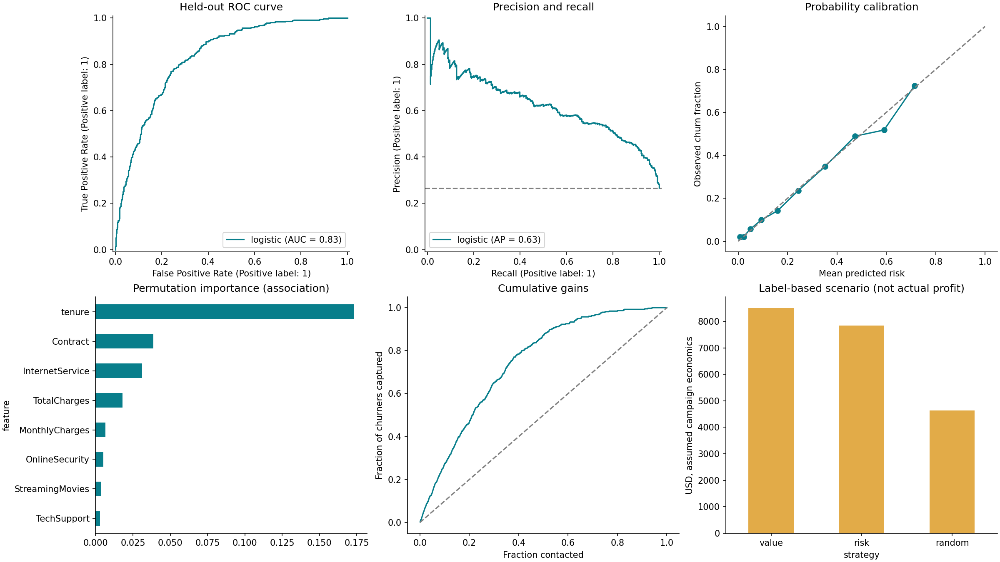

# Value-Based Customer Churn Prediction & Prioritized Retention List

**Joseph Ikogho · Data Science Portfolio Project**  
Public IBM Telco Sample · Logistic Regression · Recall-first Screening · Revenue Prioritization  
Designed by Nova Agentic

## The Business Decision

**Whom should retention teams call first, and how much can they justify spending?** Churn prediction alone treats a $20/month customer like a $100/month customer. This project translates risk into monthly financial exposure, then attaches a transparent retention budget and an actionable ranked list.

**Core Score: Expected Monthly Revenue Loss = P(churn) × Monthly Customer Value.** The model is deliberately simple. Most of the project's value is in financial definitions, asymmetric mistakes, resource allocation and intervention assumptions.

The main project uses the public [IBM Telco Customer Churn sample](https://github.com/IBM/telco-customer-churn-on-icp4d). It contains 7,043 sample records; this is not a live company portfolio or evidence of realized savings. The earlier pension-member work remains a **separate, explicitly synthetic extension** under [`extensions/pension`](extensions/pension/README.md).

## Results and Tradeoffs

| Held-out Evidence | Result |
|---|---:|
| Test Customers | 1,409 |
| Recall-first Threshold (chosen on validation) | 0.24 |
| Validation recall target / achieved | ≥85% / 85.3% |
| Test Recall | **82.9%** |
| Test recall at default 0.50 | 53.5% |
| Test precision at recall-first threshold | 48.4% |
| Churners Caught / Missed | 310 / 64 |
| Nonchurners Flagged | 330 |
| ROC AUC / Average Precision | 0.833 / 0.625 |
| Brier Score | 0.141 |
| Expected monthly revenue exposure, all test customers | **$28,314** |
| Six-month constant-revenue Exposure Scenario | $169,887 |
| Expected saved revenue, 200-contact uniform-cost campaign | $17,781 |
| Expected net contribution, same campaign | $8,447 |

The validation target is not a guarantee of 85% test or future recall. Lowering the threshold catches 110 additional test churners versus 0.50, while increasing unnecessary calls. **Financial amounts are modeled exposures/scenarios, not achieved savings.** Campaign assumptions: 25% of otherwise churners saved, six retained billing months, 70% contribution margin and $20 all-in cost per contacted customer.



## The Prioritized Action List

[`outputs/prioritized_call_list.csv`](outputs/prioritized_call_list.csv) ranks **all** held-out customers by the exact monthly score. The flag is a separate screening signal; a high-value, lower-probability account can outrank a flagged low-value account. Actual outcomes are excluded from outreach lists.

| priority_rank | customerID | probability | monthly_customer_value | expected_monthly_loss | max_incentive_after_outreach | suggested_support_tier |
|---|---|---|---|---|---|---|
| 1 | 1400-MMYXY | 0.78 | 105.90 | 82.32 | 81.43 | Dedicated advisor |
| 2 | 6023-YEBUP | 0.81 | 100.95 | 81.48 | 80.55 | Dedicated advisor |
| 3 | 8884-ADFVN | 0.79 | 101.95 | 80.40 | 79.42 | Dedicated advisor |
| 4 | 2027-FECZV | 0.74 | 106.70 | 78.55 | 77.47 | Dedicated advisor |
| 5 | 0702-PGIBZ | 0.77 | 101.70 | 78.27 | 77.18 | Dedicated advisor |

The list includes rank, ID, probability, flag, monthly customer value, expected monthly loss, break-even total retention spend, remaining incentive cap, an illustrative support tier and expected contribution after that tier. [`flagged_customers.csv`](outputs/flagged_customers.csv) is the recall-first flagged subset; [`retention_queue.csv`](outputs/retention_queue.csv) is the separate capacity-constrained, positive-value uniform-cost campaign queue.

## Financial Framework

For probability p, monthly revenue V, retained months H, assumed conditional save rate s, contribution margin m and outreach cost c:

| Quantity | Formula | Interpretation |
|---|---|---|
| Expected monthly revenue loss | p × V | Required ranking score |
| Horizon exposure | p × V × H | Constant-revenue scenario, not a multi-month churn forecast |
| Expected saved revenue | p × V × H × s | Assumes the intervention prevents a fraction of otherwise churners |
| Break-even total retention spend | p × V × H × s × m | Maximum total spend before modeled contribution reaches zero |
| Maximum incentive after outreach | max(0, break-even total spend − c) | Remaining affordable support/offer cost |
| Expected net contribution | expected saved revenue × m − all-in retention cost | Scenario return after cost, not realized ROI |

Example: p=0.50, V=$100, H=6, s=25%, m=70%, outreach=$5. Monthly exposure is $50; expected saved revenue is $75; break-even total spend is $52.50; remaining incentive cap is $47.50. A $35 advisor-support cost plus $5 outreach leaves $12.50 expected contribution. Paying the full cap leaves zero contribution, so the suggested tier must cost **strictly less** than its cap.

**Illustrative tiers:** dedicated advisor ($35) if affordable; otherwise promo code ($10); otherwise outreach only ($5); otherwise no paid outreach. These are example expected costs and affordability rules. They do not prove advisor support is more effective than a promo code. The chosen tier is the highest affordable example tier, not an estimated optimal treatment.

The uniform-cost campaign is a **separate scenario**: $20 all-in cost per contact, not $20 plus the tier charges. It uses the same assumed save rate and selects positive-value customers up to capacity. With common costs, margins and save rates, sorting by p × V also sorts by expected net value. If costs or treatment effects vary by customer, that equivalence no longer holds.

## Weighing false positives against false negatives

A **false positive** calls a customer who would have stayed. A **false negative** misses a churner. The walkthrough says missing a churner is more costly, so the project makes this assumption explicit rather than optimizing accuracy.

The default threshold is the **highest validation threshold with at least 85% recall**. Taking the highest qualifying threshold limits unnecessary calls. Maximizing unconstrained recall would simply flag everyone; precision is reported as a capacity burden, not the primary goal. F2, ROC AUC, average precision, calibration and Brier are secondary diagnostics.

The illustrative screening-cost scenario sets **FP=$20, FN=$100 (5:1)**. On the test set, the recall-first rule costs $13,000 in these diagnostic penalties versus $19,840 at threshold 0.50. These figures are **not retention profit or company-validated costs**. The assumed ratio is examined at 1:1, 3:1, 5:1 and 10:1 in [`outputs/error_cost_sensitivity.csv`](outputs/error_cost_sensitivity.csv). A cost-minimizing comparison threshold is selected on validation for each ratio and evaluated on test. The recall-target rule need not minimize every ratio.

## Simple, Leakage-safe Approach

1. Convert eleven blank cumulative charges to missing values. Exclude ID, target and demographic fields from predictors; retain gender and senior indicator only for a descriptive audit.
2. Fixed seed 42, stratified 60/20/20 split: 4,225 train, 1,409 validation, 1,409 test; each ID occurs once.
3. Fit only a prior-probability baseline and **logistic regression** (C=1). No complex-model competition or hyperparameter search.
4. Median imputation, standard scaling and one-hot encoding fit inside each of five training-only calibration folds. Sigmoid calibration supports probability-based dollar estimates.
5. Set the recall-first threshold and cost-comparison thresholds on validation only. Keep the model frozen; test labels are used for evaluation, not action scoring.
6. Rank customers by p × monthly value; attach spending limits and intervention scenarios. Export the evidence and actionable lists separately.

IBM supplies a cross-sectional churn label, not timestamped forward outcomes. This benchmark predicts that supplied label and illustrates future-risk deployment; it does **not** validate a prospective one-month or six-month churn horizon. The monthly unit is a customer-value unit. Production needs pre-churn feature lineage, time-stamped snapshots and a temporal holdout.

## Business Recommendations

- Start a capacity-limited pilot with the largest expected monthly exposures, excluding contacts whose expected contribution cannot cover all-in cost. Show the recall flag and dollar rank separately.
- Use the spending cap to set an upper bound on outreach plus incentives. Prefer a cheaper proven-effective option when one exists; do not spend more simply because the account can afford it.
- Investigate service concerns using appropriately authorized customer information. Associations such as contract term or tenure are not proof that changing them prevents churn.
- Randomize outreach versus control within prespecified risk/value bands. Record contact cost, incentive redemption and retained revenue; evaluate incremental contribution with uncertainty. Use treatment-specific save rates only after suitable evidence exists.
- Monitor calibration, recall, outreach volume, subgroup errors, data drift and realized contribution. Revisit thresholds and budgets when real missed-churn versus unnecessary-contact costs are known.

## Run and Reproduce

Python **3.12** recommended. Extract the archive and open a terminal inside `value-based-churn`.

```bash
python -m venv .venv
# macOS/Linux:
source .venv/bin/activate
# Windows PowerShell instead:
# .venv\Scripts\Activate.ps1
python -m pip install -r requirements.txt
streamlit run app.py
```

The fitted model, executed notebook, data and results are included. For a no-code overview, open `PORTFOLIO_OVERVIEW.html` locally. The dashboard is local; no hosted demo is claimed.

```bash
python -m src.train
python -m src.score data/example_customers.csv outputs/new_scores.csv
python -m pytest -q
```

Open [`notebooks/01_value_based_churn.ipynb`](notebooks/01_value_based_churn.ipynb) in VS Code or Jupyter. Load only the trusted supplied joblib model. The scoring interface validates IDs, categories, finite/nonnegative numerical inputs and optional missing cumulative charges. A new data source must use the same schema and business meanings, not just the same column names.

## Repository Map

| File | Purpose |
|---|---|
| `src/train.py` | Simple model, calibration, recall rule, cost analysis and evaluation |
| `src/business.py` | Exact monthly ranking, incentive caps, tiers and campaign arithmetic |
| `src/score.py` | Validated batch inference without targets |
| `app.py` | Call list, spending limits, ROI scenarios, error tradeoffs and CSV scoring |
| `notebooks/01_value_based_churn.ipynb` | Executed reasoning and analysis |
| `outputs/prioritized_call_list.csv` | Exact p × monthly value ranking and spending limits |
| `outputs/validation_threshold_tradeoffs.csv` | Validation recall/precision/cost by threshold |
| `outputs/error_cost_sensitivity.csv` | FP/FN sensitivity and test comparisons |
| `CASE_STUDY.md` | Recruiter narrative and decision justification |
| `REQUIREMENTS_AUDIT.md` | Checklist mapping this brief and screenshots to evidence |
| `MODEL_CARD.md`, `DATA_DICTIONARY.md` | Intended use, data definitions and limits |
| `GITHUB_GUIDE.md` | Repository upload and recruiter presentation |
| `tests/`, `.github/workflows/` | Local checks, push/PR CI and manual reproduction |
| `extensions/pension/` | Separate synthetic member-transfer and fee-exposure example |

## Limits and Licensing

No realized retention outcomes, causal uplift, lifetime value, treatment-specific effects or actual company savings are established. Financial scenarios assume constant monthly charges, margin, save rate and a retained horizon without repeat churn or discounting. Fixed-model bootstrap AUC intervals exclude retraining uncertainty. Proxy bias can remain after demographic exclusion. The pension extension uses fabricated data and treats assets and fee revenue separately; its results must not be mixed with the Telco benchmark.

Code: MIT (`LICENSE`). IBM sample data: upstream Apache 2.0 license retained in `DATA_LICENSE`, with source and SHA-256 in `NOTICE` and `outputs/metrics.json`. No screenshots or private member/customer records are redistributed.
