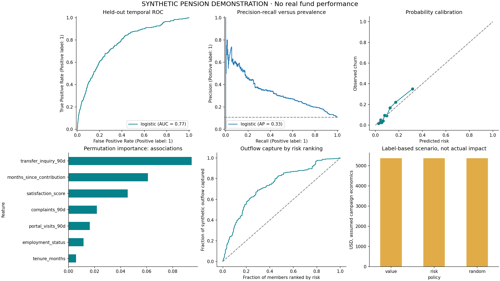

# Pension member churn prediction with financial exposure

**Joseph Ikogho · Data Science Portfolio Project 1**  
**Synthetic data demonstration** · Python · scikit-learn · Streamlit · Temporal validation  
Designed by Nova Agentic

## Goal and required tasks

**Identify potential leavers and support a retention intervention before they leave.** The model identifies risk; stopping departures requires a measured intervention, which this demonstration does not claim to have delivered.

| Requested task | Implemented answer | Output |
|---|---|---|
| List pension members who might leave | Member-level 90-day probability and binary risk flag | `outputs/flagged_members.csv` |
| Show how much each departing member would take | Potential transfer amount, expected outflow, separate fee-revenue exposure | `outputs/member_predictions.csv` |
| Estimate what happens if the fund does nothing | Sum probability-weighted member outflows and fee exposure | `outputs/metrics.json` |
| Support retention | Positive-value contact queue and adjustable campaign scenario | `outputs/retention_priority.csv`, dashboard |

**No real pension dataset was supplied. All 14,400 member records and outcomes are generated by a documented synthetic process.** This demonstrates a workflow, not pension-industry predictive performance. No telecom data are renamed or reused.

## Results at a glance

| Metric | Synthetic temporal test result |
|---|---:|
| Held-out members (Jul–Dec 2025 snapshots) | 2,400 |
| Observed 90-day departure rate | 10.8% |
| Selected model | Sigmoid-calibrated logistic regression |
| ROC AUC | 0.775 (95% fixed-model bootstrap interval 0.741–0.804) |
| Average precision / baseline prevalence | 0.332 / 0.108 |
| Brier score | 0.085 |
| Recall / precision at threshold 0.10 | 70.8% / 22.8% |
| Flagged members | 807 |
| Balance that would leave **if all flagged members departed** | $64,625,425 |
| Probability-weighted 90-day outflow, **all test members** | $19,294,569 |
| Annualized fee-revenue exposure, **all test members** | $114,992 |
| Default pilot contacts / 200 maximum | 142 |
| Expected member assets retained, pilot scenario | $1,668,897 |
| Expected fee revenue preserved, pilot scenario | $11,023 |
| Expected net fee contribution, pilot scenario | $4,166 |

The test set pools unique members observed at six monthly snapshot dates; sums are **pooled cohort exposure**, not a single-date fund forecast. The default pilot assumes a 25% save rate among otherwise leavers, one year of preserved fees, 70% contribution margin and $25 all-in cost per contact. These are estimates, not actual savings. All amounts are illustrative USD.



## What the two task outputs look like

Each flagged member has a concrete amount attached. Full account transfer is the default definition of leaving in this simulation; a lower transfer fraction is an explicit sensitivity scenario.

| member_id | churn_probability_90d | amount_if_member_leaves | expected_outflow_90d | expected_annual_fee_revenue_at_risk |
|---|---|---|---|---|
| SYN-013381 | 0.80 | 19355.80 | 15390.04 | 115.43 |
| SYN-012831 | 0.73 | 23629.53 | 17163.68 | 51.49 |
| SYN-012165 | 0.70 | 105371.63 | 74178.18 | 741.78 |
| SYN-013471 | 0.62 | 16356.88 | 10100.45 | 101.00 |
| SYN-012404 | 0.61 | 95422.63 | 58370.11 | 583.70 |

`amount_if_member_leaves` is conditional on departure. `expected_outflow_90d` weights that amount by risk. Historical `actual_churn_90d` and `actual_outflow_90d` are included only in the evaluation export; they are excluded from inference inputs and dashboard outreach downloads.

## Financial definitions

For each member, with probability p, balance B, transfer fraction w and annual fee rate f:

- **Amount if the member leaves:** B × w.
- **Expected 90-day fund outflow:** p × B × w.
- **Annual fee revenue if the member leaves:** B × w × f.
- **Expected annualized fee revenue at risk:** p × B × w × f.
- **Expected assets retained by outreach:** p × B × w × assumed save rate.
- **Expected fee revenue preserved:** p × B × w × f × save rate × fee years.
- **Expected net contribution:** preserved fee revenue × contribution margin − all-in contact cost.

Member assets are **not** the administrator's revenue. Annualized fee exposure is an annual run-rate after exit; it is not revenue lost during the 90-day prediction window. Constant balances and rates, no future contributions or market returns, and full transfers are simplifying assumptions. This is not a pension valuation or an eligibility/tax calculation.

Example: a member with a $100,000 balance, 80% exit risk and a 0.5% annual fee has $100,000 conditional transfer exposure, $80,000 expected outflow and $400 expected annual fee exposure. At a 25% save rate, 70% margin and $25 contact cost, expected net contribution is $45—not $80,000.

## Run locally

Use **Python 3.12**. Extract the ZIP and open a terminal in `pension-churn-revenue`.

```bash
python -m venv .venv
# macOS/Linux:
source .venv/bin/activate
# Windows PowerShell instead:
# .venv\Scripts\Activate.ps1
python -m pip install -r requirements.txt
streamlit run app.py
```

The trusted fitted model and outputs are included. `PORTFOLIO_OVERVIEW.html` provides a visual overview without running Python. The dashboard is local, not hosted. Uploaded CSVs are processed by your local Streamlit server. Never load an untrusted joblib model.

```bash
# Reproduce the complete synthetic benchmark:
python -m src.generate_data
python -m src.train
# Score data without target/outcome columns:
python -m src.score data/example_members.csv outputs/new_member_scores.csv
# Verify financial arithmetic, schema, temporal boundaries and inference:
python -m pytest -q
```

## Method and leakage controls

**Target:** voluntary full transfer of the member's current balance within 90 days after snapshot. This scenario excludes retirement, death, compulsory moves and ordinary benefit payments. It is an artificial label rule, not a claim about a particular pension system.

Ten pre-snapshot inputs cover balance, contributions, tenure, engagement, service complaints, transfer inquiries and fee rate. All activity windows end at the snapshot date. Age is excluded from predictors and retained for a descriptive audit. Member IDs, outcome-window dates, actual churn and realized outflows are not features.

| Role | Snapshot period | Members | Use |
|---|---|---:|---|
| Base fitting | Jan–Dec 2023 | 4,800 | Fit imputers, scaler, encoder and candidate models |
| Internal embargo | Jan–Mar 2024 | 1,200 | Excluded so fitting outcomes mature before calibration |
| Calibration | Apr–Jun 2024 | 1,200 | Fit sigmoid probability calibration on frozen base models |
| Embargo | Jul–Sep 2024 | 1,200 | Excluded so calibration outcomes mature before validation |
| Validation | Oct 2024–Mar 2025 | 2,400 | Select model and threshold |
| Embargo | Apr–Jun 2025 | 1,200 | Excluded so validation outcomes mature before test |
| Test | Jul–Dec 2025 | 2,400 | Final evaluation only |

Every member occurs once. Ninety-day outcome windows mature before the next stage begins. The final December 2025 test outcome matures in March 2026. Training candidates are a prior-only baseline, logistic regression and histogram gradient boosting. Numeric survey missingness is imputed using fitting-period medians; scaling and one-hot encoding also fit only on base fitting data. Calibrated classifiers use frozen base estimators and a later calibration period.

Validation **Brier score** chooses probability quality because financial estimates depend on it. Validation **F2** chooses the flag threshold to emphasize recall. This threshold is a statistical choice, not a cost-optimal threshold. The positive-value contact queue is a separate decision among flagged members. Model and threshold are frozen before evaluating test data. Calibration and EDA results on the test set are diagnostic, not selection inputs.

At the selected threshold, 184 leavers are caught and 76 missed; 623 staying members are flagged. This is a substantial outreach burden, so the project does not present a flag as certainty. A higher threshold reduces contacts but may miss more leavers.

## Retention decision and validation

Prioritize flagged members by expected positive net fee contribution, up to capacity. Capacity is a ceiling: the default selects only 142 economically eligible contacts. A value policy, risk policy and fixed-seed random policy share the same eligibility filter. At the default capacity all 142 eligible members are selected, so the three policies tie; reduce capacity to 50 in the dashboard or notebook to examine ranking differences. Value ranking maximizes the stated formula by construction; its modeled superiority is not proof of causal impact. The label-based scenario substitutes historical synthetic outcomes for probabilities but still assumes the save rate.

A real pilot should randomize outreach versus control within prespecified risk/value bands, verify contact permissions, record service issues and offer costs, and measure 90-day transfers plus later retained fee contribution. Use intent-to-treat analysis and uncertainty intervals. Offer assistance without obstructing a member's choice to transfer. Estimate heterogeneous treatment uplift only after suitable treatment data exist.

## Repository guide

| Path | Contents |
|---|---|
| `app.py` | Two task views, economics, retention simulation, batch scoring |
| `src/generate_data.py` | Transparent seeded synthetic process |
| `src/train.py` | Temporal splits, calibration, model selection, evidence and exports |
| `src/business.py` | Input validation and independently testable financial definitions |
| `src/score.py` | Inference from a member CSV |
| `notebooks/01_pension_churn.ipynb` | Executed end-to-end analysis |
| `data/synthetic_members.csv` | Synthetic snapshots and outcomes |
| `data/example_members.csv` | Inference-only schema example |
| `outputs/` | Trained model, member lists, metrics, charts, audit and sensitivity |
| `tests/` | Unit and integration checks |
| `.github/workflows/` | Push/PR checks and manually triggered reproduction |
| `CASE_STUDY.md` | Recruiter narrative and interview explanations |
| `MODEL_CARD.md` | Intended use, limits and monitoring |
| `DATA_DICTIONARY.md` | Field definitions and data provenance |
| `GITHUB_GUIDE.md` | Upload and presentation checklist |

## Limits and next steps

Synthetic signals are deliberately designed by the generator; matching them does not establish real-world pension performance. No actual fund data, regulatory rules, causal retention effects, customer contact integration or production security review are included. Age exclusion does not guarantee fairness. Permutation importance is associative; changing a feature is not a proven remedy. The AUC interval resamples test members for a fixed model, not training processes; no financial causal confidence interval is justified.

Next: obtain appropriately authorized, de-identified member snapshots; define fund-specific voluntary exits and transferable balances; verify pre-outcome availability; evaluate an untouched temporal holdout; and run a randomized retention pilot. For a real single-date forecast, score the current eligible member roster at one common cutoff, rather than summing historical cohort snapshots.

## Author and license

Joseph Ikogho. Source code and synthetic data: MIT, see `LICENSE`. Designed by Nova Agentic. The project follows the supplied pension-churn goal and tasks; screenshots are not redistributed. Version history: `CHANGELOG.md`.
